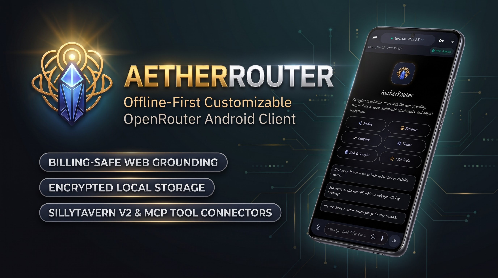

<div align="center">



# ⚡ AetherRouter

**A high-craft, customizable OpenRouter API client for Android — built for power users, creative studios, and mobile-first developers.**


-3DDC84?style=for-the-badge&logo=android&logoColor=white)


</div>

---

## ✨ Overview

**AetherRouter** is a native Kotlin & Jetpack Compose Android frontend for [OpenRouter](https://openrouter.ai/) that packs desktop-grade AI orchestration, encrypted local storage, SillyTavern-compatible roleplay tooling, Model Context Protocol (MCP) support, live usage analytics, and a built-in GitHub & Code Artifact Studio into a single mobile workspace.

---

## 🚀 Key Features

### 🧠 Core AI Engine & Streaming
- **OkHttp SSE Streaming:** Real-time token streaming with `reasoning_details` replay and structured API error handling (`OpenRouterApiException`).
- **Stateful Model Picker:** Browse, search, filter, and sort OpenRouter models with persistent scroll position, query, and sort preferences stored via DataStore.
- **Side-by-Side Model Compare:** Run and compare responses across multiple models in a dedicated comparison overlay.
- **Context & Cost Estimator:** Real-time token tracking, context window visibility, cost estimation, and slash-command shortcuts.
- **Live Clock & Smart Replies:** Optional real-time clock/timestamp injection and quick smart-reply generation.

### 🔐 Privacy & Encrypted Local Vault
- **AES-256-GCM Encryption at Rest:** All local Room database records (Schema v4) are encrypted via `CryptoManager`.
- **Biometric Vault Lock:** Hardware-backed biometric lock overlay that automatically wipes sensitive in-memory caches and search indices on lock events.
- **Encrypted SAF Backups & Exports:** Full backup, restore, and shareable export cards via Android Storage Access Framework (SAF).

### 🎭 Persona Studio, Lorebooks & Roleplay Tools
- **SillyTavern V2 Character Cards:** Native parsing and management via `PersonaCardEngine` and `PersonaStudioOverlay`.
- **Global Lorebooks:** Dynamic world-info and lorebook injection across chats (`GlobalLorebook`).
- **Sampler Presets:** Save, switch, and fine-tune custom generation parameters (`SamplerPreset`).
- **Message Swiping:** Generate and swipe between multiple response variants (`MessageSwipe`) right inside the message bubble.
- **Project Folders:** Organize conversations into structured project workspaces.

### 🛠️ Agentic Tools, MCP & Web Intelligence
- **MCP Tools Hub:** Built-in Model Context Protocol JSON-RPC client (`McpJsonRpcClient`) and interactive tools hub.
- **Live Web Search & Fetch:** Agentic `openrouter:web_search` and `openrouter:web_fetch` support with a hardened in-app WebView browser (`InAppBrowserOverlay`).
- **Document Extraction:** Attach and extract text from local documents directly into context (`DocumentExtractor`).

### 💻 Credits Dashboard, Code & GitHub Studio
- **Usage & Credits Studio:** Live OpenRouter balance and rate-limit monitoring (`GET /api/v1/key`), plus optional Management API Key integration for 30-day `/api/v1/activity` breakdowns.
- **Built-in GitHub Studio:** Connect a GitHub Personal Access Token (PAT) to browse repos, inspect files, and push code directly from Android.
- **Live Code Artifact Preview:** One-tap code artifact saving and live in-app HTML/JS rendering (`LiveArtifactPreviewOverlay`).

### 🎨 Expressive Material 3 UX & Media
- **Appearance Studio:** Material 3 Expressive theming with true `#000000` AMOLED dark mode and bundled typography (`Plus Jakarta Sans`, `Space Grotesk`, `Newsreader`, and `JetBrains Mono`).
- **Rich Markdown & Media Tray:** Full Markdown rendering, syntax-highlighted code blocks, and an animated GIF, sticker, and emoji tray powered by Coil.
- **Voice Mode:** Dedicated voice overlay with integrated speech-to-text and text-to-speech (`VoiceEngineManager`).

---

## 🏗️ Project Architecture

```text
app/src/main/java/com/example/
├── MainActivity.kt                  # Single-activity Jetpack Compose entry point
├── core/                            # Encryption, biometrics, personas, voice, exports, clock & artifacts
│   ├── BiometricVaultHelper.kt
│   ├── CodeArtifactUtils.kt
│   ├── ContextAndCostEstimator.kt
│   ├── CryptoManager.kt
│   ├── DocumentExtractor.kt
│   ├── ExportManager.kt
│   ├── LiveClockProvider.kt
│   ├── PersonaCardEngine.kt
│   ├── SmartReplyGenerator.kt
│   └── VoiceEngineManager.kt
├── data/
│   ├── local/                       # Room DB (v4), DAOs, Entities & DataStore preferences
│   ├── model/                       # Domain & Phase 4 studio models
│   └── repository/                  # VaultRepository & UsageRepository
├── network/                         # OpenRouter REST/SSE, LiveWebFetcher, MCP JSON-RPC & GitHub API
├── ui/
│   ├── screens/                     # ChatWorkspaceScreen
│   ├── components/                  # Studios, overlays, pickers, markdown, bubbles & browser
│   └── theme/                       # Material 3 AMOLED colors & custom typography
└── viewmodel/                       # AppContainer, ChatViewModel & ModelPickerViewModel
```

---

## 🧰 Tech Stack

| Layer | Technology |
| :--- | :--- |
| **Language** | Kotlin |
| **UI Toolkit** | Jetpack Compose + Material 3 |
| **Networking** | OkHttp (SSE Streaming & REST) |
| **Persistence** | Room Database (Schema v4) + Jetpack DataStore |
| **Security** | Android Biometric API + AES-256-GCM (`CryptoManager`) |
| **Media** | Coil (Animated GIFs & Stickers) |
| **Protocols** | OpenRouter API, MCP (JSON-RPC), GitHub REST API |
| **SDK Targets** | `minSdk 24` (Android 7.0) → `targetSdk 36` |

---

## ⚙️ Getting Started

### Prerequisites
- Android Studio (or Gradle CLI) with JDK 17+
- An [OpenRouter API Key](https://openrouter.ai/keys)
- *(Optional)* OpenRouter Management API Key for 30-day activity analytics
- *(Optional)* GitHub Personal Access Token (PAT) for GitHub Studio

### Build & Run
1. Clone the repository:
   ```bash
   git clone https://github.com/Cexey/AetherRouter.git
   cd AetherRouter
   ```
2. Copy `.env.example` if configuring local environment variables, or enter your API keys directly inside **AetherRouter → Settings** on first launch.
3. Build the debug APK:
   ```bash
   ./gradlew assembleDebug
   ```
4. Install on your Android device (Android 7.0+ / API 24+).

---

## 👤 Author

Built by **[Cexey](https://github.com/Cexey)** — *Cexey's Creations*
